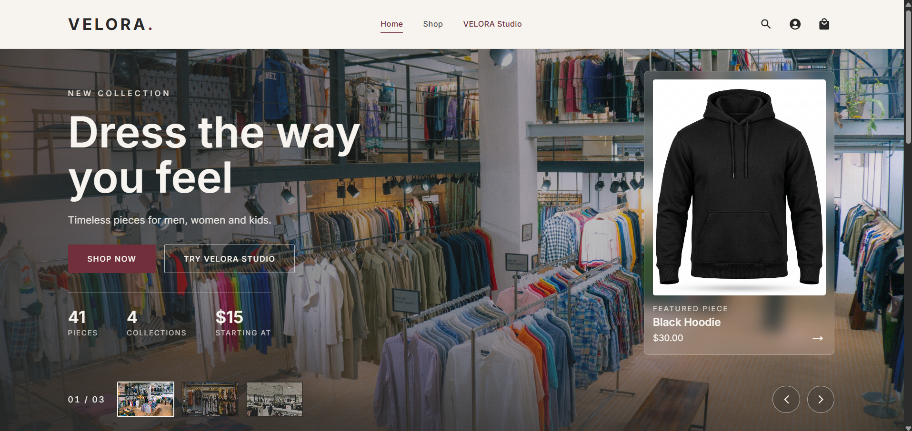
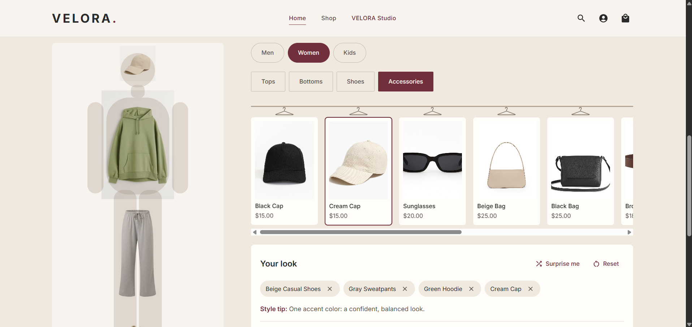
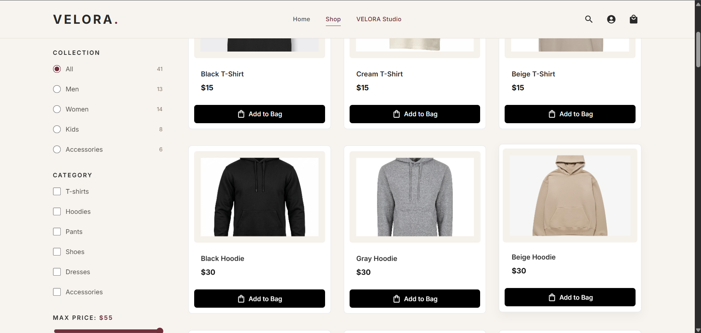
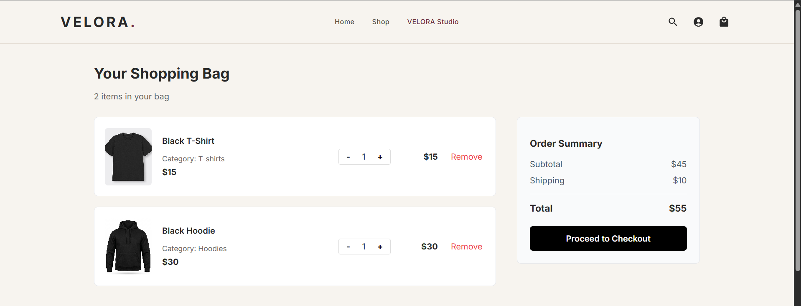
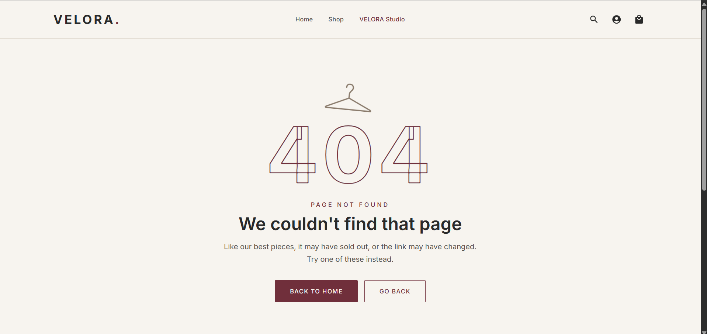

# VELORA

**A Modern Fashion E-Commerce Website**

VELORA is a modern fashion e-commerce website designed to provide a smooth and enjoyable shopping experience. Users can explore different clothing collections, browse products, filter by categories and prices, add items to their shopping bag, and complete their orders easily.

## Screenshots

<table align="center">
  <tr>
    <td colspan="2" align="center">
      
    </td>
  </tr>
  <tr>
    <td width="50%">
      
    </td>
    <td width="50%">
      
    </td>
  </tr>
  <tr>
    <td width="50%">
      
    </td>
    <td width="50%">
      
    </td>
  </tr>
</table>

## How to Use

1. Browse the available clothing collections.
2. Explore products and apply filters.
3. Add your favorite items to the shopping bag.
4. Review your selected products and update quantities.
5. Proceed to checkout and complete your order.

## Installation

```bash
git clone https://github.com/Osama-dev20/VELORA.git

cd VELORA/frontend

npm install

npm run dev
```
